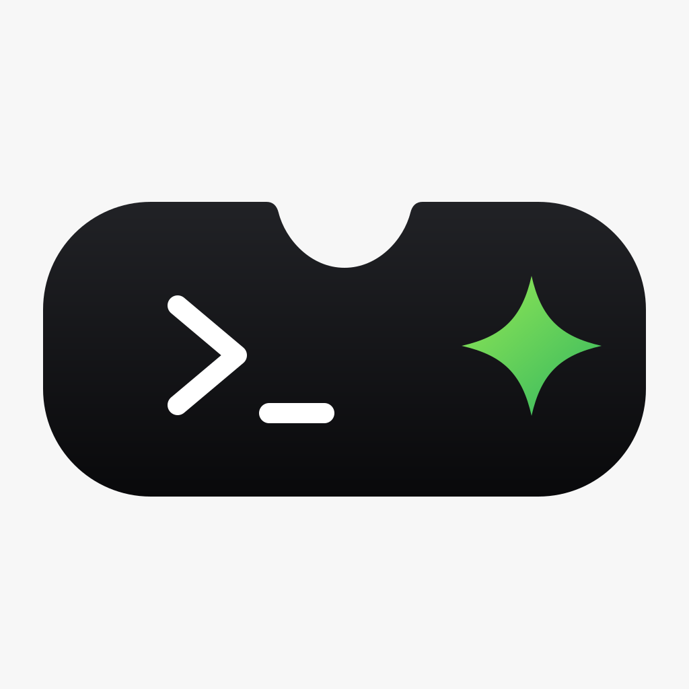
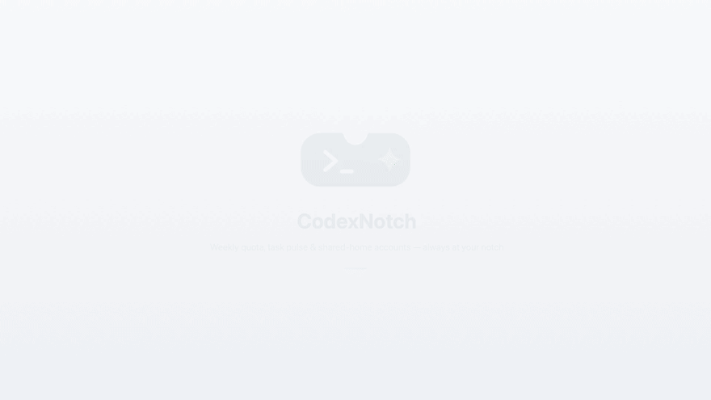

<div align="center">

# CodexNotch



### Your Codex quota—always in sight.

**Weekly quota, five-hour details, exact reset times, multi-account switching, and live task status beside your MacBook notch.**<br>
Stay in your IDE, browser, or terminal—your quota and activity remain right at the top of your screen.

[](https://github.com/fengdwx/codex-notch/releases/latest)
[](Package.swift)
[](https://github.com/fengdwx/codex-notch/releases/latest)
[](LICENSE)
[](https://linux.do)

[**Download Latest Release**](https://github.com/fengdwx/codex-notch/releases/latest) · [**Watch Demo**](docs/assets/codex-notch-demo-en.mp4) · [简体中文](README.zh-CN.md)

</div>

[](docs/assets/codex-notch-demo-en.mp4)

<p align="center"><sub>Real app capture: weekly quota, five-hour detail, exact reset timestamps, reset-credit expiries, cross-app visibility, and live task state.</sub></p>

## What's New in 2.x

- **Built-in multi-account switching (`~/.codex` shared home)**: Save multiple ChatGPT/Codex accounts in an isolated local `0700`/`0600` vault and switch directly from the notch drawer or **Settings → Accounts**, keeping projects, threads, and New Chat workspace context intact across switches via `.codex-global-state.json` synchronization.
- **Browser-sandbox OAuth sign-in**: Add or re-authenticate accounts via **+ Sign in** using an isolated `app-server` OAuth flow without signing out of or interrupting your active Codex desktop session.
- **On-demand vertical drawer & live hover preview**: Collapses to a compact `36pt` anchor bar by default (`Available`, `Recent`, and `All` filters for 5+ accounts) and previews standby `5h + 7d` quotas live in the header ring and progress bars with zero vertical layout jump.
- **Hardened switch safety**: Quits Codex before capturing shutdown-rotated tokens with freshness comparison, detects conflicting standalone Codex CLI/IDE processes before swapping credentials, and automatically restores your previous session if relaunch fails.
- **Modernized macOS Settings & External Island**: Fixed unified-chrome sidebar (`General`, `Appearance`, `External Island`, `Accounts`), refined frameless notch icon, contrast-locked capsule switches honoring **Reduce Motion**, and quick **Check Updates** / **GitHub** links.

> Upgrading to **2.1.0**: Removed the obsolete external `CodexAccountSwitcher` auto-import; use **+ Sign in**, **Import auth.json**, or **Adopt local login** cleanly inside **Settings → Accounts**.

---

## Why CodexNotch

Codex usage windows are easy to lose track of behind full-screen IDEs and browsers. CodexNotch keeps the three things that matter pinned beside your MacBook notch—or centered as an **External Island** on displays without a notch:

- **How much weekly and five-hour quota remains?**
- **Exactly when does each window (and reset credit) reset?**
- **Is Codex currently running a task, idle, or just finished?**

| You care about | How CodexNotch answers |
| --- | --- |
| **Remaining quota** | Weekly quota stays on the right (`clockwise ring` or `wave ball`); on a physical notch with a 5h window returned, 5h appears on the left. Hovering shows detailed progress bars. |
| **Exact reset timing** | Displays the exact reset timestamp plus a live second-by-second countdown, and expands reset-credit expiry details when available. |
| **App switching** | Stays visible across every app and Space without depending on any third-party notch host. |
| **Task status & navigation** | Shows live running pulses, idle state, or a ~5-second green completion checkmark. Click any active or recent conversation to jump straight to `codex://threads/<thread-id>`. |
| **Multi-account comparison** | Compare `5h` and `7d` limits across saved accounts by hovering standby cards before confirming a switch. |

---

## Key Capabilities

### Notch & External Island Layouts

- **Physical-notch Macs**: Compact indicators stay aligned inside the left and right safe areas (`24pt` alignment containers), clear of the camera cutout, and expand smoothly downward inside a pre-allocated transparent canvas that yields mouse events after collapse.
- **External or notchless displays**: Renders a centered **External Island** at the top of the screen with four selectable center styles (`Signature`, `Orbit`, `Elapsed Timer`, and `Minimal Flow`) previewable anytime inside **Settings → External Island**.
- **Quota semantics**: Dynamically classifies quota windows from `limit_window_seconds` (so 7-day weekly-only plans never masquerade as 5-hour windows). Colors shift smoothly along `QuotaColorScale`; numbers stay inside the indicator without repetition.

### Multi-Account Management

Manage multiple ChatGPT/Codex accounts safely without juggling separate `CODEX_HOME` directories or rebuilding project sidebars:

1. **Add accounts your way**: Authenticate new accounts in an isolated browser sandbox (**+ Sign in**), import an exported `auth.json`, or adopt the currently active `~/.codex/auth.json` login.
2. **Share one project pool**: Every account continues working inside `~/.codex`. Before relaunching Codex on a switch, CodexNotch captures the outgoing token *after* Codex flushes on exit (preventing stale token overwrites), writes the target credential atomically, and syncs `.codex-global-state.json` project continuation state.
3. **Clear health states**: Expired/signed-out (`401`) accounts are flagged **Re-auth** and unavailable (`402`/`403`) accounts are excluded from healthy standby counts and **Available-first** sorting until refreshed or re-authenticated.

### Verified In-App Updates

Manual update checks via **Settings → Check Updates** use **Sparkle 2.9.6** with an Ed25519 signature check against `SUPublicEDKey` in `Info.plist`, downloading, verifying, installing, and relaunching signed GitHub Release archives on your explicit confirmation.

---

## Install

Download from [**GitHub Releases**](https://github.com/fengdwx/codex-notch/releases/latest) (Apple Silicon, macOS 14 Sonoma or later):

1. Open the `.dmg` disk image (or unzip the `.zip` archive).
2. Drag `CodexNotch.app` into `/Applications`.
3. Launch CodexNotch. If macOS displays an unnotarized developer prompt on first launch (public builds use ad-hoc signing), choose **Open Anyway** in **System Settings → Privacy & Security**, or Control-click the app and choose **Open**.

By default CodexNotch reads `~/.codex` (or `$CODEX_HOME` if set before launch). Swift and Xcode are not required to run prebuilt releases.

---

## Customization

Open Settings from the lower-right of the expanded notch card, the notch context menu, or `Cmd+,`:

- **General**: Launch at login, live Chinese / English language switch, recent conversation count (`0–5`; `0` hides the history list).
- **Appearance**: Clockwise quota ring or wave ball, left status mark style (`Codex` / `ChatGPT` / `Off`), display visibility, and animation switch (respecting both the app toggle and system **Reduce Motion**).
- **External Island**: Choose `Signature`, `Orbit`, `Elapsed Timer`, or `Minimal Flow` with an up-to-12-character signature and live interactive stage preview.
- **Accounts**: Add via browser sandbox OAuth, import `auth.json` or active login, rename/add local-only notes, refresh per-account quotas, reveal `~/.codex`, export, or switch/relaunch accounts.

---

## Data & Privacy

- **Local-only credentials**: Saved tokens stay in `~/Library/Application Support/CodexNotch/Accounts/Vault` with strict `0700` directory / `0600` file permissions and are never logged, cached in plain telemetry, or uploaded.
- **Read-only quota lookups**: Quota and reset-credit checks call ChatGPT's read-only usage endpoint; only a user-confirmed **Use reset** action submits a credit redemption.
- **Minimal local log parsing**: Task state reads rollout JSONL streams in `CODEX_HOME/sessions`; conversation titles read short labels from `session_index.jsonl` and read-only `state_5.sqlite` without storing message bodies.
- **Zero telemetry**: Update checks fetch a static public GitHub `appcast.xml` and send no Codex credentials, quotas, or conversation data.

---

<details>
<summary><strong>Build from source</strong></summary>

Requires Xcode 16+ (CI validates with Xcode 16.2 on `macos-15`) targeting macOS 14.0+:

```sh
swift test
./scripts/verify.sh
./scripts/build_app.sh
open dist/CodexNotch.app
```

Create distributable ZIP, DMG, SHA-256 checksums, and a signed local appcast (requires the publisher Sparkle Keychain key):

```sh
RUN_TESTS=0 ./scripts/release.sh
```

Build without ad-hoc signing during local development:

```sh
SIGN_IDENTITY=none ./scripts/build_app.sh
```

See [docs/updating.md](docs/updating.md) for the release & signing workflow and [docs/agent-harness.md](docs/agent-harness.md) for contract verification rules.

</details>

---

## Scope & Boundaries

CodexNotch focuses on lightweight local quota telemetry, task visibility, and fast multi-account switching. It intentionally does **not** kill background tasks silently without user confirmation, calculate API token billing, sync credentials to the cloud, send remote notifications, auto-install updates in the background, or monitor ChatGPT Classic (`com.openai.chatgpt.classic`).

---

## Acknowledgments & References

CodexNotch is an independent native macOS application with no runtime plugin dependency on external notch hosts, and is grateful to the open-source projects and ecosystem works that shaped its architecture:

- [**Atoll**](https://github.com/Ebullioscopic/Atoll) — Inspired CodexNotch's fixed transparent canvas layering, damped spring transitions, and non-intrusive hover interaction beside the physical notch (documented in [ADR 001](docs/decisions/001-fixed-canvas-notch-motion.md), [ADR 035](docs/decisions/035-spring-card-transitions.md), and [ADR 045](docs/decisions/045-hover-response-and-shadow.md)).
- [**Sparkle**](https://github.com/sparkle-project/Sparkle) — Powers Ed25519-verified, user-initiated in-app updates ([Sparkle Documentation](https://sparkle-project.org/documentation/)).
- **macOS & Codex Ecosystem** — Community explorations around local AI telemetry, notch interfaces, and developer workflows such as [**CodexBar**](https://github.com/steipete/CodexBar) and [**CC Switch**](https://github.com/farion1231/cc-switch), as well as feedback from the [LINUX DO](https://linux.do) community.

---

## License

Released under the [MIT License](LICENSE). If CodexNotch keeps your quota in sight and saves a few context switches, a Star is always appreciated.
