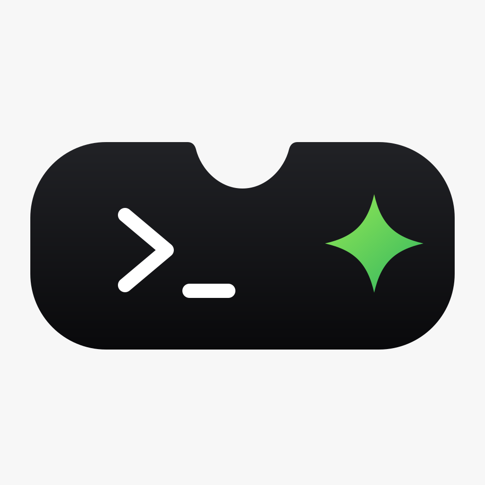

<div align="center">

# CodexNotch



### Codex 额度，始终在眼前。

**把周额度、5 小时明细、精确重置时间、多账号切换和实时任务状态，固定在 MacBook 刘海旁。**<br>
切到浏览器、IDE 或终端，额度与任务状态依然一目了然。

[](https://github.com/fengdwx/codex-notch/releases/latest)
[](Package.swift)
[](https://github.com/fengdwx/codex-notch/releases/latest)
[](LICENSE)
[](https://linux.do)

[**下载最新版**](https://github.com/fengdwx/codex-notch/releases/latest) · [**观看 26 秒演示**](docs/assets/codex-notch-demo-zh.mp4) · [English](README.md)

</div>

[](docs/assets/codex-notch-demo-zh.mp4)

<p align="center"><sub>真实 App 录屏：周额度、5 小时明细、精确重置时间、重置机会到期提示、跨应用可见性与实时任务状态。</sub></p>

## 2.x 核心更新

- **原生多账号管理（共用 `~/.codex` 工作区）**：将多个 ChatGPT/Codex 登录保存在本机 `0700`/`0600` 加密目录权限的保险库中，可在刘海抽屉或 **设置 → 账号** 一键切换；切号时自动同步 `.codex-global-state.json` 项目与新建对话上下文，所有账号继续共用同一份项目列表和会话历史。
- **独立沙盒网页 OAuth 登录**：通过设置页右上角 **+ 网页登录** 启动隔离的 `app-server` 登录流程，无需退出当前 Codex 客户端即可添加新账号或刷新过期凭据。
- **按需展开账号抽屉与悬停实时预览**：默认收起为 `36pt` 紧凑锚点栏；展开后支持「余量优先 / 最近使用 / 全部」筛选（5 个及以上账号自动出现），悬停备用账号卡片即可在顶部圆环与进度条实时对比 `5h + 7d` 余量且卡片高度零跳变。
- **切号安全加固与自动回滚**：先优雅退出 Codex 再按令牌新鲜度回存刷新后的 token，切号前安全检测外部冲突的 Codex CLI/IDE 进程，并在重启失败时自动恢复原账号会话。
- **全新 macOS 设置界面与外接屏悬浮岛**：固定尺寸统一质感侧边栏（通用、外观、外接屏悬浮岛、账号）、圆润无框品牌图标、兼容系统「减少动态效果」的常亮胶囊开关，以及左下角「检查更新」与 GitHub 入口。

> **2.1.0 调整说明**：移除旧版外部 `CodexAccountSwitcher` 自动迁移与「同步原切换器」入口，统一使用 **+ 网页登录**、**导入 `auth.json` 文件** 或 **导入当前本地登录** 添加账号。

---

## 为什么做 CodexNotch

写代码时很容易因为切换窗口而忘了还剩多少额度。CodexNotch 把最关心的信息固定在物理刘海两侧（无刘海或外接显示器则自动居中显示为**外接屏悬浮岛**）：

- **本周与 5 小时窗口各自还剩多少额度？**
- **精确到秒的重置时间，以及重置机会何时到期？**
- **当前任务还在运行、已完成，还是已经空闲？**

| 你关心的 | CodexNotch 如何展示 |
| --- | --- |
| **额度还剩多少** | 右侧固定展示周额度（顺时针圆环或波浪球）；物理刘海且返回 5 小时窗口时左侧显示 5h；悬停展开详细进度条。 |
| **何时重置** | 展开卡片直接展示具体重置时间与秒级倒计时，点击「可重置 N 次」可查看每次重置机会的精确到期时间。 |
| **切到其他软件会不会消失** | 不会。作为独立原生应用常驻屏幕顶部，不依赖任何第三方刘海宿主程序。 |
| **任务状态与快速跳转** | 区分运行中、空闲及约 5 秒绿色完成对勾；点击展开卡里的近期任务可直接跳回 `codex://threads/<thread-id>`。 |
| **多个账号怎么对比余量** | 悬停刘海抽屉里的任意备用账号即可在顶部实时预览其 `5h` 与 `7d` 余量，确认后再切换。 |

---

## 核心功能详解

### 物理刘海与外接屏悬浮岛

- **刘海屏模式**：左右指示器均居中锚定在安全区域内（`24pt` 对齐容器），严格避开摄像头遮挡；悬停时在预分配透明画布内纯向下展开，收起后立即释放画布，不拦截刘海外的任何鼠标操作。
- **外接屏 / 无刘海屏模式**：在屏幕顶部居中展示**外接屏悬浮岛**，提供「个人签名」「轨道签名」「任务计时」「极简光带」四种中间样式，可在 **设置 → 外接屏悬浮岛** 中随时实时预览并自定义最多 12 个字符的签名。
- **准确的额度窗口语义**：依据接口返回的 `limit_window_seconds` 动态识别窗口周期，避免仅含 7 天额度的计划被误显示为 5 小时窗口；颜色按余量由绿平滑过渡到红，数字始终内置于指示器中不重复堆叠。

### 多账号切换机制

CodexNotch 采用「共享工作区 + 本地凭据保险库」设计，不拆散你原有的本地项目与对话记录：

1. **三种添加方式**：点击 **+ 网页登录** 在沙盒浏览器中授权添加、导入导出的 `auth.json` 文件，或一键收编当前 `~/.codex/auth.json` 登录态。
2. **退出优先捕获 + 同步延续**：切换账号时先退出 Codex 让其落盘最新刷新令牌，再对比新鲜度权威回存到 Vault，原子写入目标 `auth.json` 并同步 `.codex-global-state.json` 项目池，避免切号后工作区变空。
3. **可用性状态识别**：遇到 `401` 或凭据失效会自动标记「需重登」，`402`/`403` 标记「不可用」，并将其排除在健康备用数与「余量优先」排序之外。

### 安全的应用内更新

通过侧边栏左下角 **检查更新** 调用 **Sparkle 2.9.6**，严格使用 `Info.plist` 内置公钥校验 GitHub Release 压缩包的 Ed25519 签名；仅在用户主动操作后下载、校验、替换并重启。

---

## 安装指南

前往 [**GitHub Releases**](https://github.com/fengdwx/codex-notch/releases/latest) 下载最新版本（支持 Apple Silicon，系统要求 macOS 14 Sonoma 及以上）：

1. 优先下载 `.dmg`（打开后将 `CodexNotch.app` 拖入右侧 `Applications` 快捷方式），或解压 `.zip` 后手动移入“应用程序”。
2. 首次打开若因 ad-hoc 签名出现未公证提示，请在 **系统设置 → 隐私与安全性** 中点击“仍要打开”，或右键应用选择“打开”。
3. 确保本机已至少登录并使用过一次 ChatGPT / Codex，再启动 CodexNotch。

默认读取 `~/.codex` 目录；如通过环境变量覆盖，可在启动前设置 `CODEX_HOME`。直接使用发行包无需安装 Xcode 或 Swift 工具链。

---

## 个性化设置

悬停刘海点击展开卡右下角「设置」，或通过刘海右键菜单、`Cmd+,` 打开设置窗口：

- **通用**：登录时自动启动、中/英文界面切换、近期对话显示条数（`0–5`，设为 `0` 隐藏列表）。
- **外观**：顺时针额度圆环或波浪球切换、左侧状态图标风格（`Codex` / `ChatGPT` / `关闭`）、主显示开关及动画开关（与系统「减少动态效果」协同生效）。
- **外接屏悬浮岛**：切换无刘海与外接屏顶部中间样式、编辑自定义签名并实时预览三种任务状态。
- **账号**：网页沙盒授权登录、导入/导出、本地名称与备注编辑、单项或批量刷新额度、查看 Codex 目录及安全切号。

---

## 数据与隐私边界

- **凭据只存本机**：所有账号凭据仅保存在 `~/Library/Application Support/CodexNotch/Accounts/Vault`（目录权限 `0700`、文件权限 `0600`），不写入应用日志、缓存或上传云端。
- **只读与显式确认**：额度与重置机会查询均调用只读接口；仅当你主动点击并确认「使用重置」时才发起额度兑换请求。
- **最小化本地读取**：任务运行状态仅解析 `CODEX_HOME/sessions` 中的 rollout JSONL；会话标题优先匹配 `session_index.jsonl`，回退只读读取 `state_5.sqlite` 的标题字段，不读取或缓存对话正文。
- **零遥测收集**：检查更新仅拉取公开的 GitHub `appcast.xml`，不会附带任何账号、额度或对话信息。

---

<details>
<summary><strong>从源码构建与验证</strong></summary>

需要 Xcode 16 及以上版本（CI 在 `macos-15` 上使用 Xcode 16.2 构建），运行目标为 macOS 14.0+：

```sh
swift test
./scripts/verify.sh
./scripts/build_app.sh
open dist/CodexNotch.app
```

生成带 Sparkle 签名的分发包（需要发布者本地钥匙串签名密钥，详见 [docs/updating.md](docs/updating.md)）：

```sh
RUN_TESTS=0 ./scripts/release.sh
```

本地调试如需跳过代码签名：

```sh
SIGN_IDENTITY=none ./scripts/build_app.sh
```

变更与契约规范见 [docs/agent-harness.md](docs/agent-harness.md)。

</details>

---

## 当前边界

CodexNotch 专注于轻量级本地额度监测、任务状态提示与同工作区多账号切换；不会在未经确认的情况下静默强杀后台任务，不提供费用估算、云同步、远程推送、无人值守静默安装更新，也不监听旧版 ChatGPT Classic（`com.openai.chatgpt.classic`）。

---

## 致谢与参考

CodexNotch 是一款完全独立的原生 macOS 应用，不依赖任何第三方刘海宿主程序，谨向开发过程中给予架构启发与技术支持的开源项目及社区致谢：

- [**Atoll**](https://github.com/Ebullioscopic/Atoll) — 启发了 CodexNotch 的固定透明画布分层模型、物理阻尼弹簧动画以及非侵入式刘海悬停交互（详见架构记录 [ADR 001](docs/decisions/001-fixed-canvas-notch-motion.md)、[ADR 035](docs/decisions/035-spring-card-transitions.md) 与 [ADR 045](docs/decisions/045-hover-response-and-shadow.md)）。
- [**Sparkle**](https://github.com/sparkle-project/Sparkle) — 为应用提供基于 Ed25519 签名验证的应用内安全更新能力（[官方文档](https://sparkle-project.org/documentation/)）。
- **macOS 与 Codex 开源生态** — 感谢同领域围绕 AI 配额可视化、刘海交互与开发者工作流展开探索的优秀项目（如 [**CodexBar**](https://github.com/steipete/CodexBar)、[**CC Switch**](https://github.com/farion1231/cc-switch) 等），以及 [LINUX DO](https://linux.do) 社区提供的反馈与真机测试建议。

---

## 开源许可

本项目基于 [MIT License](LICENSE) 开源。如果 CodexNotch 帮你少切换了几次窗口、缓解了额度焦虑，欢迎点一个 Star 支持。
